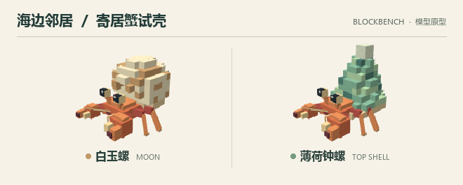
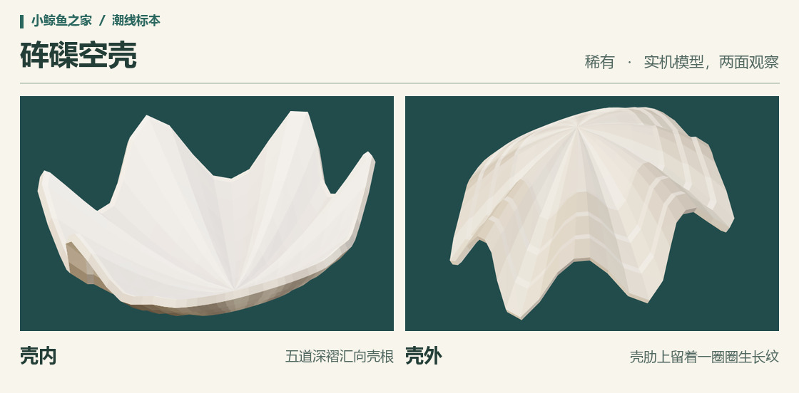

# 海边邻居：试玩指南

**这是已经接入网页小屋的玩法。** 在 `web/` 运行 `npm run build`，打开 `dist/home.html` 或 `dist/cabin.html`。正常打开就能离线游玩；`?live=0` 是不写存档的开发预览，不会发贝币或保存新住户。

## 1. 两个山洞，两位邻居

**东礁：小螃蟹送贝币。** 每天 **00:00 和 12:00** 换班。小螃蟹会回洞、带着一枚贝币横着走出来，把它放在洞前；点贝币，钱才进钱袋。点螃蟹仍会把它吓回洞，已开始的惊逃不会被送礼打断。

不必守在午夜。上午、下午首次打开都能遇到当班礼物，每个半天最多一枚，不补发错过的班次。用真实时间和小屋所在地时区，首次成功领取时固定该存档的奖励时区；变更光照、调场景时间、重开页面不会重发。落盘失败不会播收币声，可以再点。

**屋边石堆：寄居蟹试壳。** 点屋旁石堆南侧的寄居蟹或陶盘，选一枚空闲的白玉螺或薄荷钟螺，点「试这枚」。预览不会动存档；点「借给它」才确认，点「收回」就还回来。借的是有独立尺寸、花纹的**那一枚**：仍算已发现，不能同时出售、上架或放进沙盘。一次换壳同时归还旧壳，确认时新壳被占用就不换。

[寄居蟹及可换的壳](../models/creatures/hermit_crab.bbmodel)、[鱼缸](../models/shore/tide_tank.bbmodel)、[浅海鱼](../models/shore/rockpool_fish.bbmodel)都是可编辑的 Blockbench 工程。网页构建直接读取源件，不需要手动导出。寄居蟹在 `body → shell_mount` 下切换两个壳组，只开一组。模型使用内嵌色板；每个方块面对应单色格，关节保留本地枢轴。沙滩标本沿用现有三角雕塑和七种顶点色花纹。

## 2. 家具：把邻居带进小屋的生活

- **相册矮桌**：第一次确认借壳会留下当时的壳、花纹、尺寸和时间。打开想用的相册，点「把纪念照贴进这本相册」。照片按那次记录显影，之后换壳不改旧照；相册满或布置中不能添加。
- **电视**：切到「天气频道」看海滩小报：落雪或雷雨、当班可观察的鱼、下一次送币的时间与时区。
- **贝壳展柜**：在收藏详情选中具体一枚、选柜子和格子，点「设为今日展品」。空格排在最前；也可替换自动陈列。点实际展品可看花纹并听她介绍，忙时只显示提示。展品保留到手动收回；柜子消失也可以从收藏详情收回，不会丢失。
- **鱼缸和门廊沙盘**：游戏只使用原木玻璃缸和原木沙盘。精致款「海藻庭」和「潮汐标本台」的 [Blockbench 源件及画面对照已归档](../models/archive/shore-furniture/README.md)，不随游戏加载。

## 3. 收集盒：50 种标本

原有 [39 种](tide-atlas/README.md) 的标识和发现记录不变，另加 11 种。垃圾、花纹和鱼都不计入分母。旧 39/39 存档更新后是 39/50。偏好的天气只影响几率，不锁定掉落。

| 稀有度 | 新标本 |
| --- | --- |
| 常见（4） | 灰纹玉黍螺、乌贼白骨、蜂孔浮石、盘绳浮标结 |
| 少见（5） | 梯纹螺、负壳螺、石鳖甲片、鳐鱼空卵鞘、棘牡蛎壳 |
| 稀有（2） | 海百合茎化石、砗磲空壳 |

**砗磲空壳**是一瓣冲上岸的稀有空壳：内侧乳白，外侧有起伏的壳肋和生长纹。选中捡到的那一枚，可以在沙盘翻面欣赏，也可以收回后改放到展柜。

## 4. 下雪会积起来

切到雪天，保持一会儿：干沙、露天礁顶和屋顶先有小块雪斑，再逐渐连成一层。湿沙、海面、洞内和室内不铺雪。雪停会慢慢融，雨天融得更快。积雪是当前场景的视觉效果，不改变走路高度，也不在关页期间补算。换屋按新屋顶取样，切一楼或阁楼时屋顶的雪跟着隐藏。

## 5. 下水、抄鱼、养鱼

1. **岸边橙白救生圈**是下水点。点「邀请她去浅海」，她先走到岸边，再进入限定泳区；「漂一会儿」会停在水面，「上岸」沿原路返回。默认小鲸鱼用模型自带的 `main:swim` 划水，停下来也保持泳姿；旧版方块小鲸鱼会分别播放蹚水、划水、仰漂。下水前会收伞；没有泳姿的导入角色留在岸边陪看，下雨仍会撑伞。雷雨不下水，已在水中会回岸。
2. **看白色网圈**。小鱼游进圈时点鱼、网圈或「抄网」。落空可以再试。每五分钟换一拨；已经观察或带走的那尾不会靠刷新再出现。错过的时段不囤鱼，远海装饰鱼不受影响。
3. **先摆好缸，再带鱼回家**。从救生圈面板选「摆放 / 查看鱼缸」，可摆门廊边的小架或现有餐桌的一角。最多三尾，可以取名字、喂食或放归。没有缸或已满，只能观察放回；收缸、搬动、换屋、关页都不会删除住户，离线不饿死。三种鱼单列在鱼种观察册。

## 实机验收清单

用正常游玩页面（不要加 `?live=0`），最好先用一个新浏览器配置或测试存档；无需准备铜牌或其他样式的家具。

- [ ] **东礁送币**：从洞口正面和侧面各看一次小蟹出洞、放币和受惊回洞。背壳与钳子不应穿石或突然转向，贝币应从钳尖落地。点币钱袋只加 1，刷新不再领；真实时间跨本地 12:00 或 00:00 后可领下一枚。不必卡点在线。
- [ ] **寄居蟹与纪念照**：用白玉螺或薄荷钟螺依次试壳、借出、换壳、收回。试壳不占库存；借出的那枚不能卖或摆进沙盘，归还后可以。把第一次换壳贴入相册，再次换壳后老照片不变。
- [ ] **收集与家具**：收集盒分母为 50，鱼和垃圾不计入。若捡到稀有的砗磲空壳，在原木沙盘翻面看壳肋与白色内壁；收回后设为「今日展品」，点击摆件看介绍。电视天气频道应能报出下一班送币时间。
- [ ] **游泳与安全**：点橙白救生圈，邀请默认小鲸鱼下水、漂一会儿、继续游、上岸。看手臂划水、水线和上岸衔接；切到旧版方块小鲸鱼可另看仰漂。游到一半切雷雨，她应自动回岸。
- [ ] **捞鱼与存档**：用原木玻璃缸接鱼，等鱼进入白圈再抄网。取名、喂食、搬缸后刷新，鱼和名字应还在；放归后观察册仍记得。不同的五分钟时段可继续抓，满三尾不能再带回。
- [ ] **积雪与日常**：雪天看干沙、屋顶、露天礁石变白，海水、湿沙、室内不积雪；停雪应逐渐融化。将「消遣」时长调短观察看书或看电视是否自行结束；备好零食，提高自己吃的概率，核对吃一份只扣一份。

## 存档与验证

离线和本机服务共用同一套收藏规则。旧档没有 `shore` 时按空记录升级；新字段随收藏备份导入导出。使用本机服务时要将本次构建的 `dist/inventory-rules.mjs` 与网页一起更新；仍在返回旧格式的服务只能观察，不会悄悄把钱、壳和鱼另存到浏览器。详见[存档接入](INVENTORY-V2.md)。

- `npm test`：API、角色行为、自主活动时长、零食事件、螃蟹进出洞，以及新存档规则、模型、50 种收藏／七种花纹、积雪、泳区与回岸。
- `npm run test:shore-browser`：用独立浏览器和临时存档走一遍实际领币、试壳、相册、展柜、抄鱼、养鱼、重开和雪面显隐；点真实救生圈，检查划臂、漂浮和上岸。始终验证旧版方块小鲸鱼，本机有内置角色包时也验证默认小鲸鱼。不读写玩家存档；本机需要 Edge 或指定 `TOOLKIT_BROWSER`。
