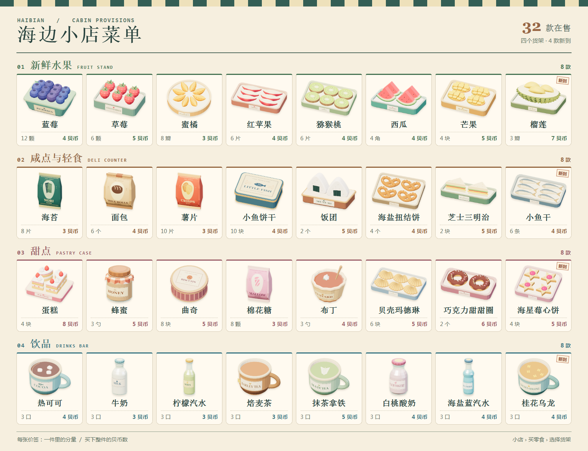

# 海边小店 · 四架补货清单

按「有多少款可以买」盘点，而不是按一盒能吃几份。每件商品只占一个货架：蜂蜜和布丁用勺吃，归甜点；白桃酸奶用瓶喝，归饮品；小鱼饼干是咸口，曲奇是甜口。

| 货架 | 原有商品 | 本轮补货 | 完成后 |
| --- | --- | --- | --- |
| 新鲜水果 | 蓝莓、草莓、蜜橘、红苹果、猕猴桃、西瓜、芒果 | 榴莲 | 8 |
| 咸点与轻食 | 海苔、面包、薯片、小鱼饼干、饭团、海盐扭结饼、芝士三明治 | 小鱼干 | 8 |
| 甜点 | 蛋糕、蜂蜜、曲奇、棉花糖、布丁、贝壳玛德琳、巧克力甜甜圈 | 海星莓心饼 | 8 |
| 饮品 | 热可可、牛奶、柠檬汽水、焙麦茶、抹茶拿铁、白桃酸奶、海盐蓝汽水 | 桂花乌龙 | 8 |

**本轮补货：** 四个货架各加一款，从 28 款增至 32 款。原有商品的售价与分量不变。榴莲只取果肉，小鱼干按条、莓心饼按块，桂花乌龙分三口喝完。

在「小店 → 买零食」切换货架即可查看。价签按整件标价，不是单份价格。

点商品图或名字可免费观赏。模型默认慢转，按住拖动可换角度，松手继续慢转，滚轮缩放。轻点盒装或袋装模型可切换整件与单份。键盘也可用方向键、加减键和回车操作；开启系统「减少动态效果」时默认不转。点右上角 ×、窗口外或按 Esc 都能回到原货架。

零食栏和冰箱上的篮子会同步显示实际余量：蓝莓逐颗减少，原本封口的零食拆开后会露出剩余份数。商店里的样品始终是满装的。

