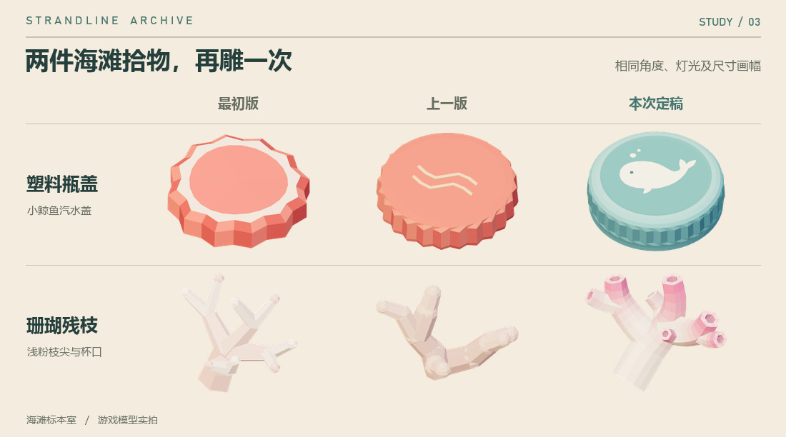
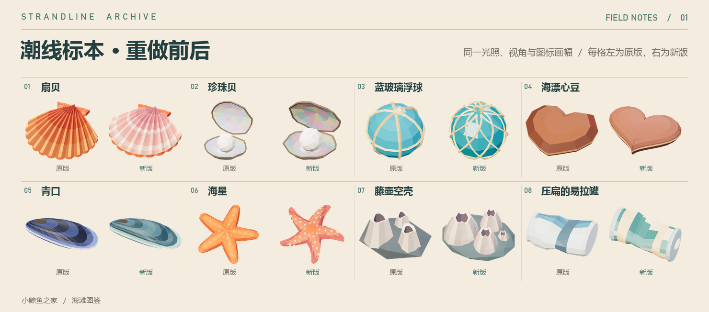
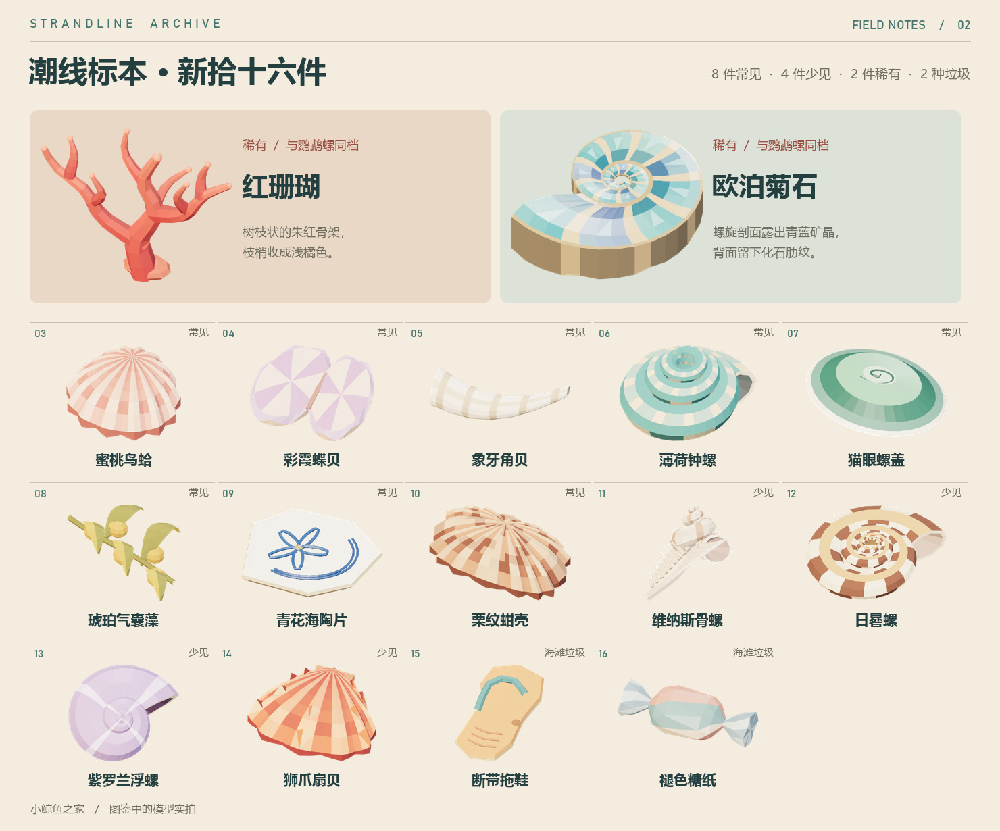

# 海滩标本图鉴

海滩现有 39 种收藏品、5 种垃圾。图中的物件均由游戏的图鉴渲染器绘制；前后对照使用相同的灯光和观察角度。旧收藏品保留原来的标识，已有存档可继续使用。

[完整花纹图谱：39 种收藏品 × 7 种外观](patterns/README.md) · [本地浏览版](patterns/index.html)

以下为上一轮全体模型重做时的历史对照。

[看全部 28 件原有掉落物的前后对照](comparison-all.jpg)

| 原版档位 | 新增内容 |
| --- | --- |
| 常见 | 蜜桃鸟蛤、彩霞蝶贝、象牙角贝、薄荷钟螺、猫眼螺盖、琥珀气囊藻、青花海陶片、栗纹蚶壳 |
| 少见 | 维纳斯骨螺、日晷螺、紫罗兰浮螺、狮爪扇贝 |
| 稀有（与鹦鹉螺同档） | 红珊瑚、欧泊菊石 |
| 垃圾（单独掉落） | 断带拖鞋、褪色糖纸 |
