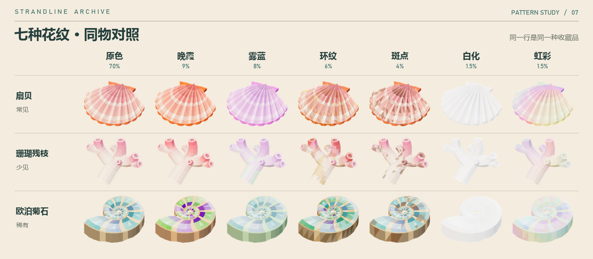
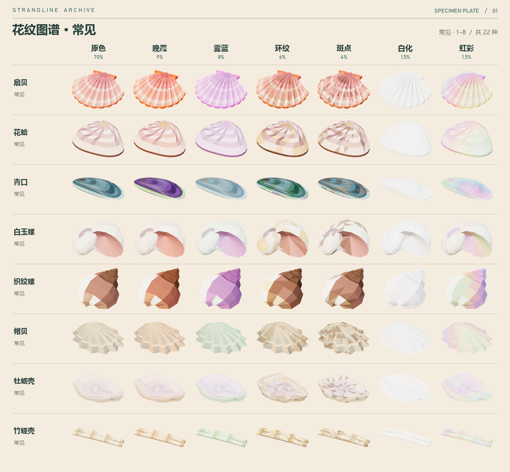
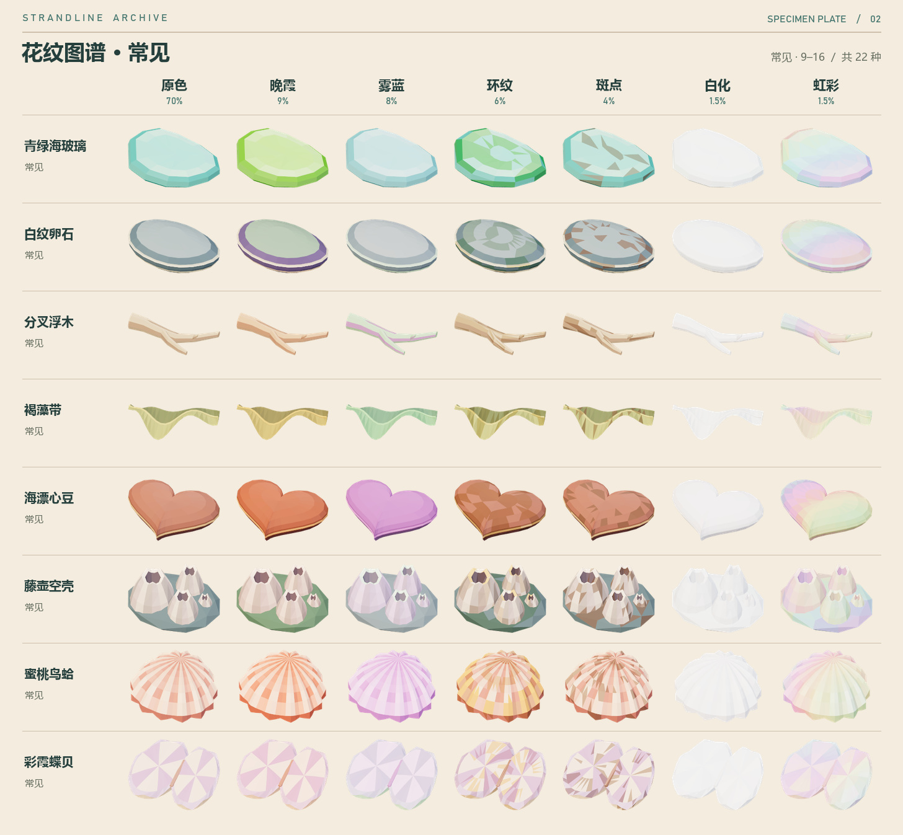
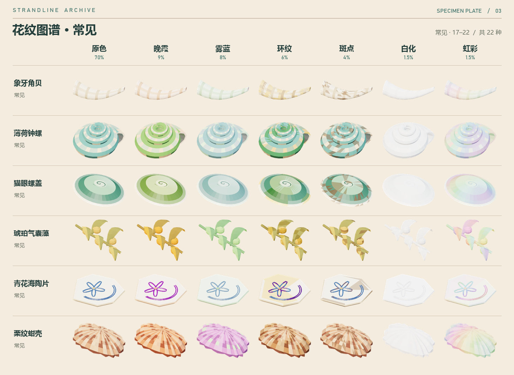
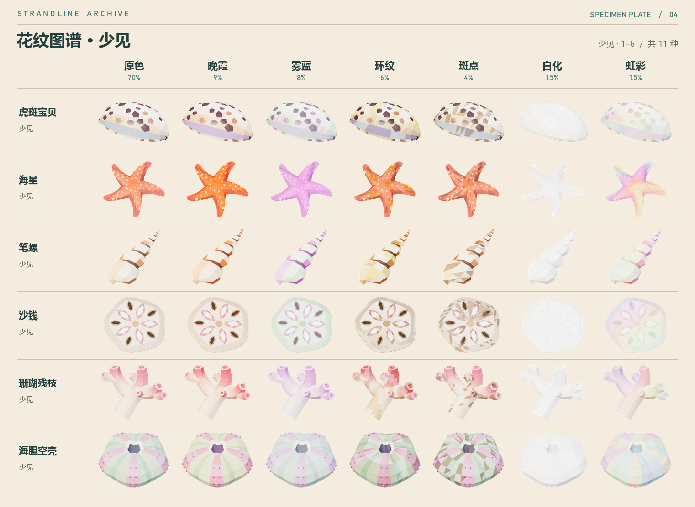
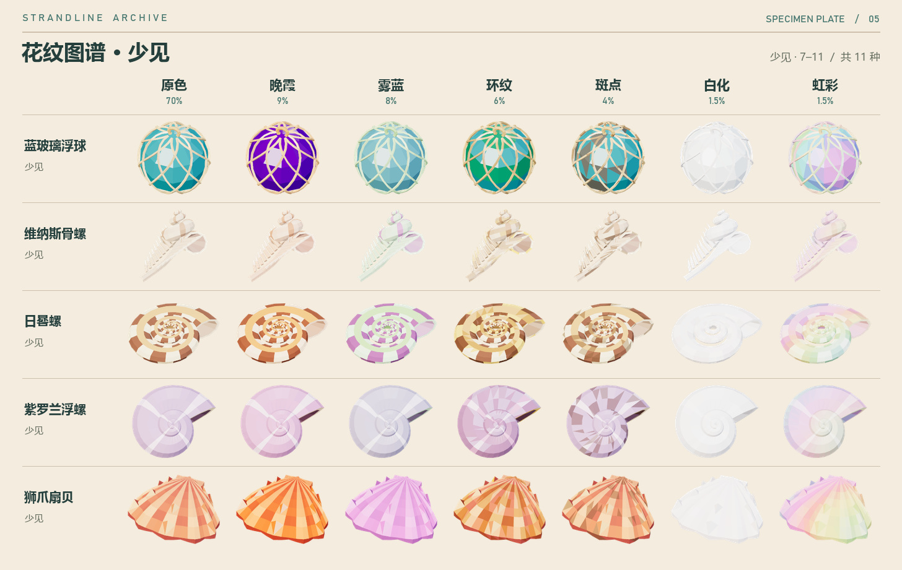
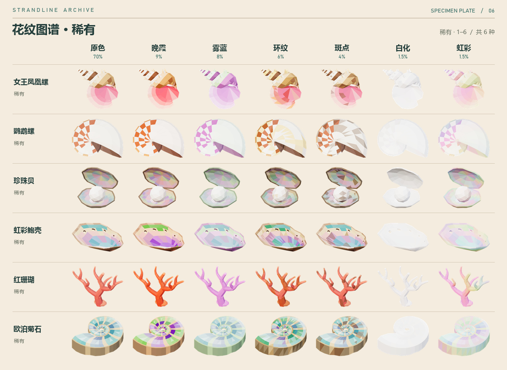

# 海滩收藏品：全部花纹对照

全部 39 种收藏品都能出现这 7 种花纹，共 273 种外观。以下图片取自游戏图鉴，同一行共用相同的模型、角度、光照和展示尺寸。实际捡到的个体还可能大小不同。

在游戏中，打开**收集盒 → 已发现的藏品 → 花纹对照**，就能查看该物种。没有发现的藏品仍然保留剪影。

| 原色 | 晚霞 | 雾蓝 | 环纹 | 斑点 | 白化 | 虹彩 |
| --- | --- | --- | --- | --- | --- | --- |
| 70% | 9% | 8% | 6% | 4% | 1.5% | 1.5% |

百分比是已经确定物种后抽到该花纹的概率。白化和虹彩属于稀有花纹；普通物种也能抽到。五种垃圾（塑料瓶盖、压扁的易拉罐、缠成团的钓线、断带拖鞋、褪色糖纸）不抽花纹。

## 按藏品找图

- [常见 · 1–8](common-1.jpg)：扇贝、花蛤、青口、白玉螺、织纹螺、帽贝、牡蛎壳、竹蛏壳
- [常见 · 9–16](common-2.jpg)：青绿海玻璃、白纹卵石、分叉浮木、褐藻带、海漂心豆、藤壶空壳、蜜桃鸟蛤、彩霞蝶贝
- [常见 · 17–22](common-3.jpg)：象牙角贝、薄荷钟螺、猫眼螺盖、琥珀气囊藻、青花海陶片、栗纹蚶壳
- [少见 · 1–6](uncommon-1.jpg)：虎斑宝贝、海星、笔螺、沙钱、珊瑚残枝、海胆空壳
- [少见 · 7–11](uncommon-2.jpg)：蓝玻璃浮球、维纳斯骨螺、日晷螺、紫罗兰浮螺、狮爪扇贝
- [稀有 · 1–6](rare-1.jpg)：女王凤凰螺、鹦鹉螺、珍珠贝、虹彩鲍壳、红珊瑚、欧泊菊石

## 完整图版

### 常见 · 1–8

### 常见 · 9–16

### 常见 · 17–22

### 少见 · 1–6

### 少见 · 7–11

### 稀有 · 1–6

