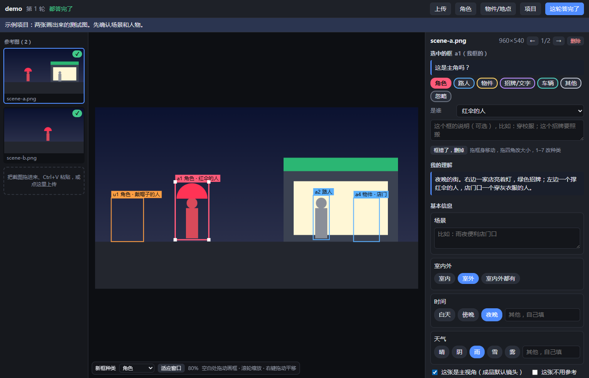
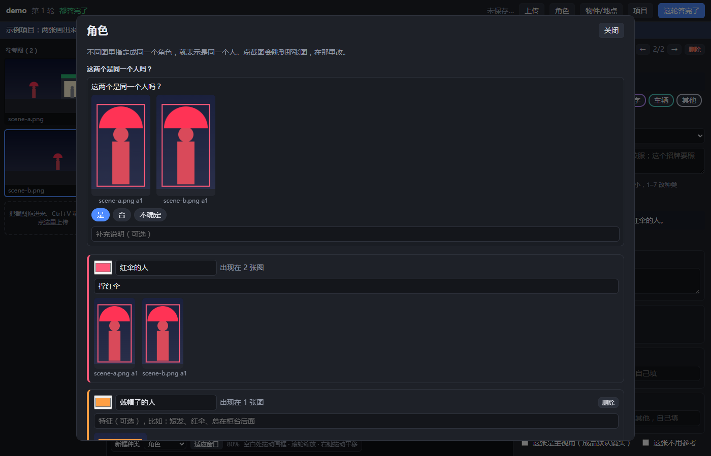
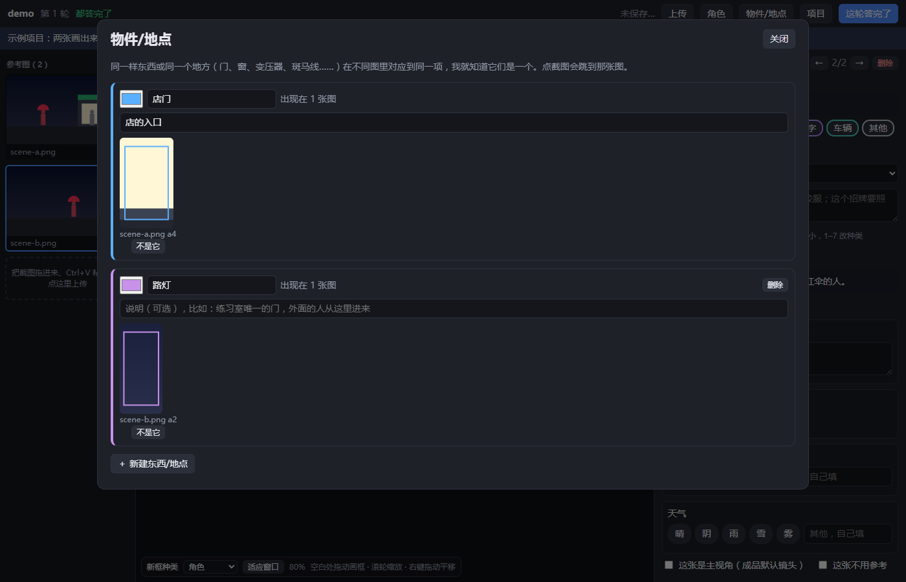

# 2D 反馈（参考图标注）使用说明

这份说明写给在页面上回答问题的人。文件格式和 agent 的流程在 [README.md](README.md)。

页面的用法：你把参考截图交进来，我看完在页面上提问；你点选、框选、填字回答，答案自动保存到项目文件夹，我再读回去。页面只在本机运行，不联网。

## 打开

1. 双击 `启动工作台.bat`，浏览器会打开工作台 http://127.0.0.1:5194/studio.html 。
2. 点左边最上面的「2D 反馈」。标注页会铺满右边，左边一栏是「项目」选择。再点「3D 反馈」就回到 3D 工作台，两边互不影响。
3. 在「项目」里选一个项目（就是 `refs/` 下面的文件夹）。「新项目」新建一个，「刷新」重新读一遍，「新标签页打开」把这个项目单独开在一个大标签页里（工作台里的这一页会先关掉，免得两边互相覆盖；回来时点「刷新」）。

工作台会记住上次停在 3D 还是 2D、看的是哪个项目。直接双击 `dist/studio.html`（不开服务）时，2D 反馈只会提示你先双击 `启动工作台.bat`。

- 不开工作台也行：`node tools/refkit/serve.mjs --dir refs/<项目名>`，浏览器打开它打印的地址（默认 http://127.0.0.1:5178/ ，端口被占用时自动换下一个）。项目文件夹不存在会自动创建。
- 想先熟悉一下：`node tools/refkit/selftest.mjs --demo refs/_demo`，然后在「项目」里选 _demo。示例项目里有两张画出来的测试图和第 1 轮问题。
- 示例：`refs/scene-01` 是做 MyGO 路口场景时答过三轮的项目，可以打开看看答完是什么样子。
- **同一个项目只开一个页面。** 工作台里的 2D 反馈和单独开的标签页也算两个。页面开着时以页面上的答案为准，两个页面同时开会互相覆盖保存。

## 页面布局

- **工作台左边一栏**（在工作台里打开时）：「3D 反馈 | 2D 反馈」切换、项目选择、简短说明。
- **顶部**：项目名、第几轮、进度、保存状态（「已保存 时间」），以及按钮「上传」「角色」「物件/地点」「项目」「这轮答完了」。
- **左侧**：缩略图。分两组：「参考图」是你交的图，「我的草图」是我画的俯视布局图等。缩略图上的数字是这张图还没答的条数，答完变成勾。
- **中间**：图和框。左下角「新框种类」选的是新画框的默认种类，「适应窗口」把图缩放到正好放下。
- **右侧**：当前这张图的问答，从上到下依次是「我的理解」「基本信息」「我的问题」「这是同一个东西吗？」「选中的框」「框」「本图备注」。没有内容的部分不显示。

## 一轮怎么答

### 1. 交图

把截图拖进页面、Ctrl+V 粘贴，或点「上传」，原图按原分辨率保存。也可以直接把文件复制进 `refs/<项目名>/images/`，几秒后页面上就会出现。

传错了，就点右侧顶部的「删除」，或者鼠标移到缩略图上点左上角的 ×。

### 2. 看「我的理解」，答「基本信息」

- 「我的理解」是我对这张图的描述。不对就在「本图备注」里写哪里不对。
- 「基本信息」有场景、室内/室外、时间、天气。我猜过的项标着「我猜：…」，猜对了点「对，确认」，不对就直接改选。
- 「这张是主视角（成品默认镜头）」：成品打开时的默认机位按这张图来定。
- 「这张不用参考」：比如角色表情特写或传错的图。勾上后这张图不再计入未答。

### 3. 答「我的问题」

题型有单选、多选、是否、填空和数字。每题都能加补充说明。我有猜测时同样标着「我猜：…」，页面不会替你作答。

### 4. 核对框

- **虚线框**是我画的、你还没确认的框。点框或点「框」列表里的一行就能选中它。
- **改种类**：在「选中的框」里点种类，或按数字键 1–7：

  | 键 | 1 | 2 | 3 | 4 | 5 | 6 | 7 |
  |---|---|---|---|---|---|---|---|
  | 种类 | 角色 | 路人 | 物件 | 招牌/文字 | 车辆 | 其他 | 忽略 |

- **确认**：猜对了点「对，确认」。猜测很多时可以点「框」标题旁的「按猜测全部确认」。
- **删除**：我画错的框点「框错了，删掉」或按 Delete。它会变淡、标上「（已删）」，选中后能点「恢复这个框」。你自己画的框会直接删掉。
- **补框**：在图上空白处拖出新框。拖框身移动，拖四个角改大小。草图上的框也一样，比如我把斑马线放错了位置，就把框拖到对的地方再确认。
- 选中框后还能写备注，比如「这是睦身后的门」。

### 5. 角色：哪几张图里是同一个人

框的种类选「角色」后，在「是谁」里选一个角色。没有就选「＋ 新角色…」并起个名字，拿不准选「不确定是谁」。不同图里的框选了同一个角色，就表示是同一个人。

顶部「角色」面板里可以改每个角色的名字、颜色和备注，下面是 ta 在各张图里的截取，方便核对。我拿不准的「这两个是同一个人吗？」也在这里问。我猜是 ta 的截取下面有「对，是 ta」。

### 6. 物件/地点：哪几张图里是同一个东西

门、窗、变压器、斑马线这类东西出现在好几张图里时，选中它的框（种类要是物件、招牌、车辆或其他），在「是哪个东西」里选同一项，没有就选「＋ 新的东西/地点…」。

- 我猜的对应会出现在右侧「这是同一个东西吗？」里，点「是」或「不是」。点「对照别的图」可以打开面板对比。
- 顶部「物件/地点」面板里可以改名字、颜色和说明。已对应的截取下面有「不是它」，我猜的截取下面有「是 / 不是」。核对过截图后，可以点「我猜的都对」一次确认。
- 面板最下面是「＋ 新建东西/地点」。

### 7. 项目

顶部「项目」面板里是整体的问题（风格、范围、人物画法等），还有四栏备注：必须一致的、可以自由发挥的、不要的、想要的动态。

### 8. 交卷

答完点「这轮答完了」。页面会保存，并导出带框的标注图给我核对，然后显示「收到」。回聊天说一声就行。没答完也可以先说，我按已答的部分推进。

我写好下一轮后，页面会在 3 秒内弹出「有新问题了（第 N 轮）」，不用刷新。

## 操作速查

| 操作 | 方式 |
|---|---|
| 画框 | 在图上空白处拖动 |
| 移动 / 改大小 | 拖框身 / 拖四个角 |
| 缩放画面 | 滚轮 |
| 平移画面 | 右键或中键拖动 |
| 复位画面 | 双击空白处，或点「适应窗口」 |
| 改种类 | 选中框后按 1–7 |
| 删除框 | 选中框后按 Delete 或 Backspace |
| 取消选择 / 关闭面板 | Esc |
| 上一张 / 下一张 | ← → 或 ↑ ↓ |
| 交图 | 拖进页面、Ctrl+V、「上传」 |

在工作台里用快捷键时，先在标注页上点一下，按键才会交给标注页；这时工作台的 3D 快捷键不会起作用。

## 常见问题

- **页面打不开**：服务没在运行。工作台的黑窗口关了的话，重新双击 `启动工作台.bat`；单独开的话，重新执行上面的命令。
- **刷新会丢答案吗**：不会。每次改动约 0.6 秒后自动存进 `answers.json`，刷新后会读回来。
- **顶部显示「保存失败」**：页面每 3 秒自动重试，服务恢复后会存上。
- **删错了图**：图在项目的 `trash/` 文件夹里，文件名前面加了删除时间（如 `20261101-062000__001.png`）。把时间前缀去掉、放回 `images/`，图和标注都会回来。
- **答过的还能改吗**：能，随时改，自动保存。点过「这轮答完了」也可以接着改。
- **图里的字太小**：页面里用滚轮放大看。招牌文字要照抄时，最好交原分辨率的 PNG 截图，或者单独截一张近景。

## 项目文件夹里有什么

    refs/<项目名>/
      images/          你交的参考图（原图）
      drafts/          我画的草图（俯视布局图、对比图等），同样可以标注
      drafts-src/      草图的 SVG 源文件
      questions.json   我写的问题和猜测
      answers.json     你的回答，页面自动保存
      answers.bak.json 每次启动服务后第一次保存前的备份
      exports/         带框的标注图
      trash/           删掉的图
